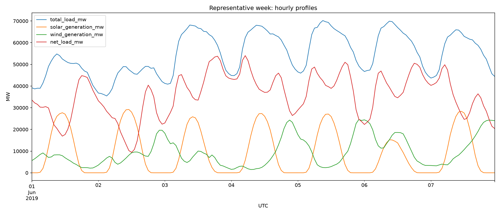
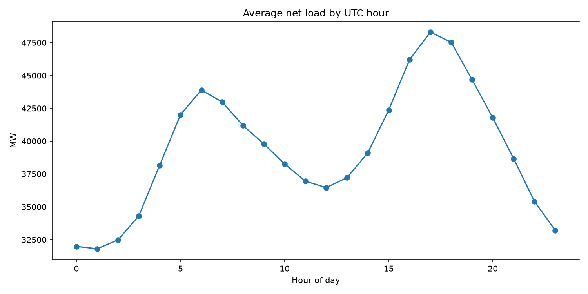
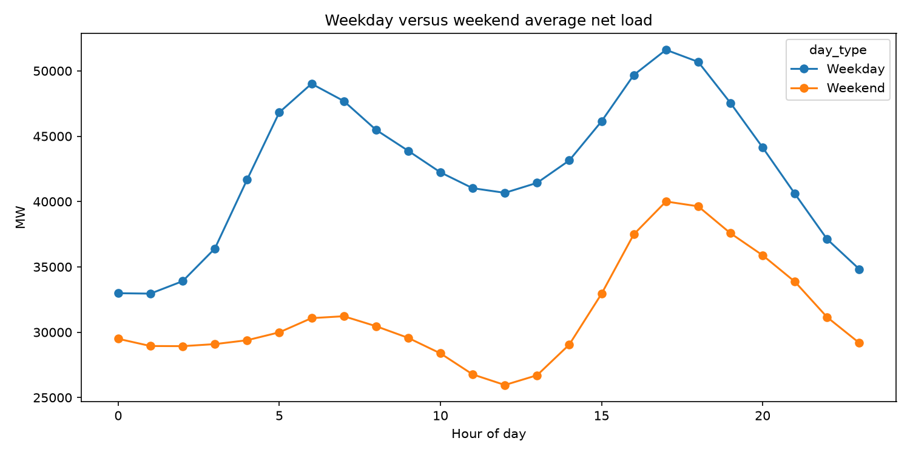
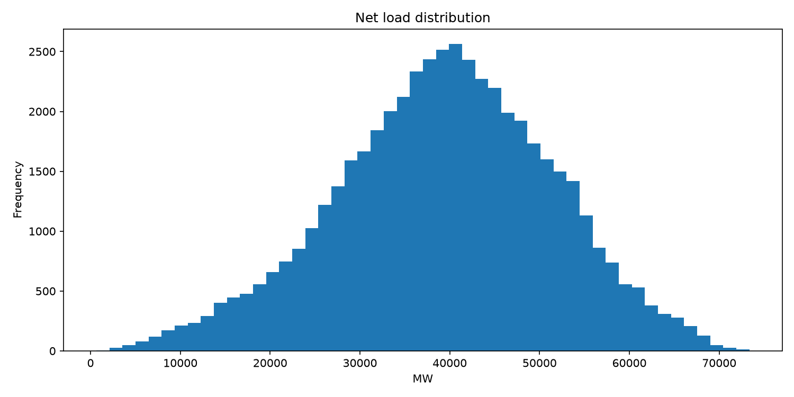
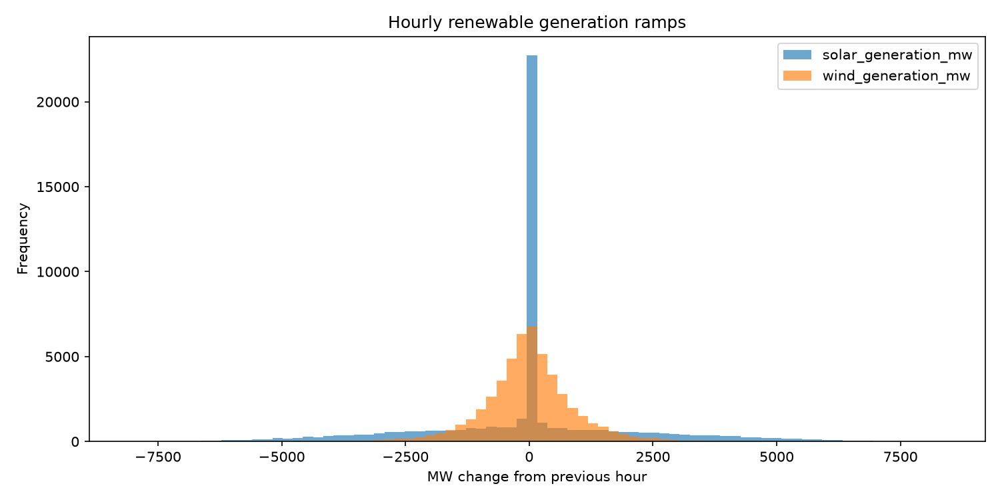
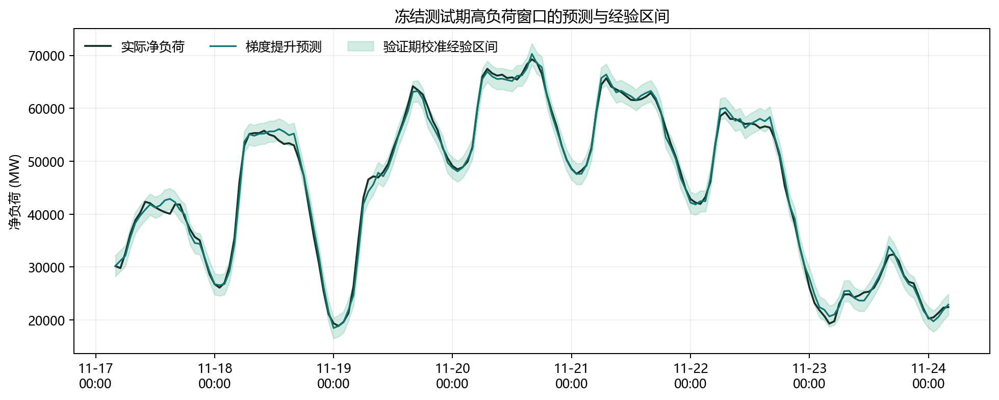
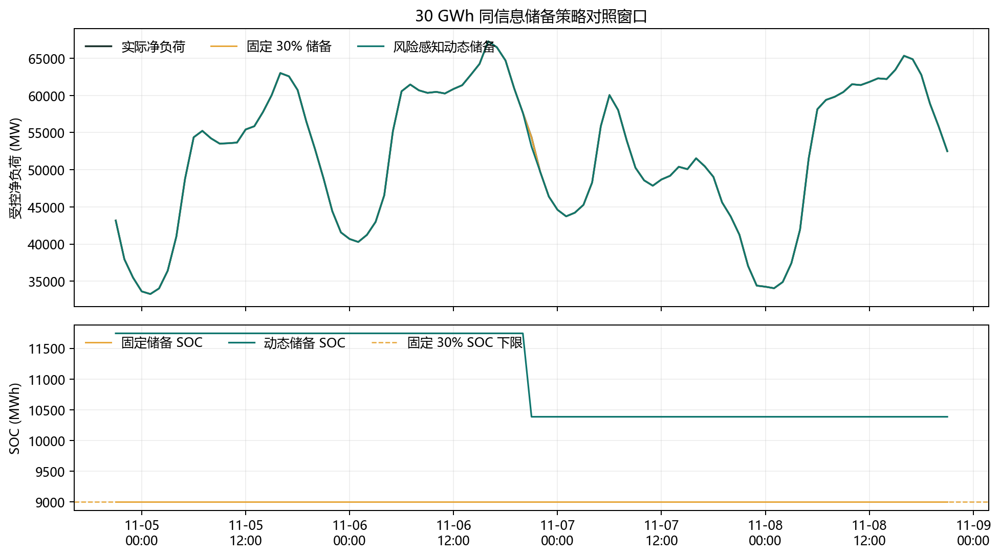
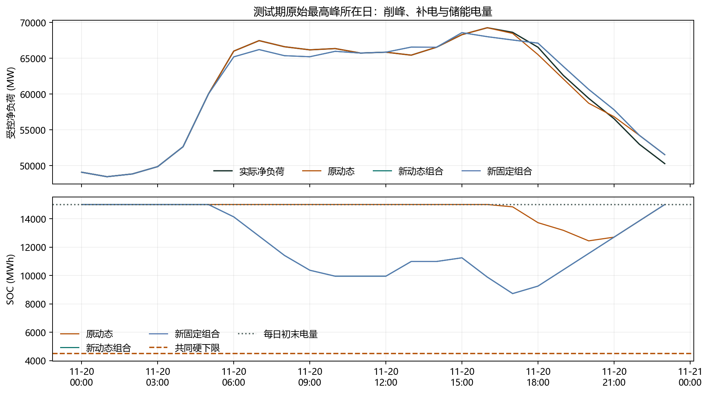

# GridPulse 赛题与作品通俗导读

核对日期：2026-10-10。本文供参赛者理解和人工审核现有作品使用，不替代正式技术报告。所有结果来自交付快照；下面的小算例只用于解释概念，不是实验数据。官网规则是赛事依据，本文的研究拆分是项目自己的设计。

## 1. 赛题究竟要求什么

这是第八届全球校园人工智能算法精英大赛“AI+能源”主题赛的科技创新组，属于自命题应用创新。官网没有为本组提供统一训练数据和固定算法小问；官网有竞赛规则及报告大纲附件。这两件事并不矛盾。

用通俗话解释任务：选择一个具体能源问题，说明为什么需要解决，使用合适的AI方法做出可运行作品，再用真实数据和对照实验说明它有什么作用、适用条件是什么。

无需完成全部十个参考主题，也不要求把生产、传输、存储、消费四个环节全部覆盖。官网列出的机器学习、大模型、智能体等是可选技术，不是必须逐项使用的清单。规则中的准确率、F1等是指标举例；连续数值预测采用MAE、RMSE，储能采用峰值、P95和能量指标才与任务匹配。

我们选择参考主题（5）“新能源消纳与并网智能调控”，涉及（3）储能优化调度，并带有（9）辅助决策的功能。题目为“GridPulse：面向新能源波动的净负荷预测与风险感知储能规划”。当前研究重点是短时净负荷压力和储能削峰，不是整个电网的一切问题，也没有证明已减少弃风弃光。

### 官方评分与我们的证据

| 官方评分项 | 分值 | 通俗理解 | 本项目对应证据与短板 |
|---|---:|---|---|
| 问题聚焦与创新价值 | 20 | 问题具体吗，方案比直接套模型多做了什么 | 预测、风险、储备和削峰串联；标准树算法不是我们发明的 |
| 需求洞察与背景分析 | 10 | 为什么有用，数据可靠吗 | 公开德国负荷与新能源数据、字段字典；不是中国园区实测 |
| 技术深度与框架构建 | 25 | 算法合适吗，工程完整且稳定吗 | 因果特征、直接多时距预测、滚动规划、模块化实现和错误处理 |
| 实验验证与结果分析 | 25 | 比较是否公平，数字能复核吗 | 强基线、消融、两年锁定复验、轨迹审计、有限实例证书及失败结果 |
| 应用价值与推广潜力 | 10 | 实际使用能带来什么 | 可作离线运行分析与储能方案评估；缺少现场、电价、设备和网络验证 |
| 反思局限与未来展望 | 10 | 是否知道自己的边界 | 披露误报、覆盖退化、循环代价、泛化限制与人工审批要求 |

上表是要求与证据映射，不是给自己打分。分值合计100分；技术与实验合计50分，说明可运行和可信实验是作品的重要部分。公开数据原型的工程应用价值仍由评委判断，不会因为代码通过测试就自动达到行业要求。

### 官方提交材料

| 材料 | 核实的官方要求 | 当前对应 |
|---|---|---|
| 技术报告 | PDF，不超过10M；参照官方大纲 | 报告PDF与Markdown源稿；本轮压缩摘要至300–500字范围 |
| 答辩材料 | 覆盖背景、技术、创新、应用；正式提交为PDF | 15页答辩PDF，附可编辑PPTX |
| 演示视频 | MP4，3–5分钟，300MB以内 | 本次不制作、不放入包，仍是正式提交前的必需项 |
| 其他材料 | 代码、模型、原型集中放入文件夹，上传百度网盘；分享永久有效并提供提取码 | 本地完整ZIP与部署说明；本次不上传网盘或报名系统 |
| 命名与匿名 | 团队编号-赛题名称-作品名称-材料名称；不得出现所在学校、指导教师信息 | 团队编号仍为占位符，正式上传前需按真实编号和平台口径命名；保留第三方来源 |
| 硬件照片/录像 | 涉及硬件或实物时提供 | 纯软件历史回测原型，不涉及硬件 |

报告模板的摘要为300–500字，小四号宋体、单倍行距；参考文献为五号宋体、20磅行距。不要把漂亮排版等同于满足全部格式要求，也不要因匿名而删除数据和开源软件的必要归属。

官网当前列明初赛作品提交截止为2026年10月15日20:00，截止后不能修改；总决赛为8分钟答辩加5分钟提问。最终以报名系统和组委会最新通知为准。

## 2. 用一个场景理解我们在解什么

假设一个区域此刻需要100MW电力，光伏提供30MW，风电提供20MW，则剩余50MW需要其他资源承担。这里的50MW就是项目定义的净负荷。

```text
净负荷 = 总用电负荷 - 光伏实际出力 - 风电实际出力
```

如果太阳落山或风速下降，即使用电量没变，净负荷也会升高。运行人员因此关心：接下来还需要多少电，可能出现什么压力，电池现在应该充电、放电还是留一些电备用？

这给出我们的三个核心输出：预测未来1–6小时净负荷；筛出值得人工检查的风险时段；在明确电池约束下模拟储能策略及其代价。项目的净负荷只减去选定光伏和风电，不等于“所有可再生能源扣除后的负荷”，也不等于某条线路负载。

MW表示某时刻的功率，MWh表示累计能量。以100MW持续1小时就是100MWh。SOC通常指电池电量比例，项目轨迹中的`storage_soc_mwh`保存剩余能量；例如30,000MWh容量中剩15,000MWh，即50%。

## 3. 第一层解答：先让数据可信

开发数据来自Open Power System Data，覆盖2015-01-01至2020-09-30，50,400条连续小时记录。每行有UTC时间、总负荷、光伏、风电和计算得到的净负荷。

“没有缺失时间戳”表示小时没有跳号；“105行存在数值缺失”表示这些小时的部分观测没有值。两者可以同时成立。数据没有被静默补成漂亮曲线，质量报告保留了缺失情况；模型只使用特征齐全的可用样本。

### 怎么看基础图

所有时间轴使用UTC，不是中国本地时间，也不是德国夏令时钟。读小时规律时必须记住这一点。

| 图 | 横轴与纵轴 | 应该观察什么 | 不能据此断言什么 |
|---|---|---|---|
| 全时段负荷与新能源曲线 | 时间；MW | 长期尺度、季节变化、负荷与新能源的关系 | 密集线条本身不证明模型准确 |
| 代表周四条曲线 | 2019-06-01至06-07；MW | 用电、光伏、风电如何共同形成净负荷 | 指定一周只是展示，不代表全年最差或最好 |
| 平均日净负荷 | UTC小时；平均MW | 日内规律，为时间特征提供直觉 | 平均值会掩盖极端时段 |
| 工作日/周末对照 | UTC小时；平均MW | 不同日类型是否有不同用电形状 | 不能由此推断某个企业的作息 |
| 净负荷分布 | 净负荷MW；出现次数 | 常见范围和高负荷尾部 | 分布不是未来概率保证 |
| 新能源小时变化分布 | 相邻小时出力差MW；次数 | 哪些变化平缓，哪些变化陡峭 | 不是新能源预测误差分布 |



读图方法：先找到总负荷曲线，再观察光伏的白天起伏和风电变化，最后看净负荷随这两类发电的扣除发生什么变化。它解释了“为什么仅预测总用电量不够”。









工程入口是`scripts/build_dataset.py`、`scripts/quality_report.py`和`scripts/eda_report.py`，数据字典见`data-dictionary.md`。质量报告在`outputs/metrics/data-quality-report.json`。

## 4. 第二层解答：预测，但不偷看未来

可以把预测模型理解为一位从过去记录中学习规律的分析员。它看到此前1小时、24小时、168小时净负荷，过去的滚动均值与波动、此前光伏风电，以及已知的小时/星期/月信息，然后估计下一时段。

梯度提升是一组逐步纠正前面误差的决策树，适合学习这些表格特征的非线性关系。模型使用现成开源实现，我们的贡献在问题设计、信息边界、验证和系统实现。

时间顺序切分相当于先学旧题，再用验证期选方案，最后在留出的后续时期测试。不能把测试小时的真实光伏或负荷先交给模型再称为预测。项目有34,875条可用训练样本、5,017条验证样本和10,035条旧测试样本。

### 对照实验为什么重要

| 方法 | 旧测试MAE | 通俗解释 |
|---|---:|---|
| 上一小时持平 | 2,382.60MW | 直接假设下一小时与上一小时一样，是更强的简单对照 |
| 24小时季节参考 | 8,760.67MW | 直接使用前一天同小时值；“24小时”指取历史值的间隔，不是预测提前24小时 |
| 168小时季节参考 | 9,774.00MW | 使用上周同小时值 |
| 梯度提升 | 1,019.87MW | 同样10,035个时间点，平均绝对误差下降 |

MAE的读法是：每次预测误差先取绝对值，再求平均。1,019.87MW是平均偏差量，不是“准确率1,019.87”，也不是每个小时的最大误差。相对持平基线，误差降低57.20%，不应把这个百分比说成97%或其他准确率。

一步预测与直接1–6小时预测是两套任务。后者为不同提前时间分别训练模型，供储能规划使用；旧测试MAE 1,019.87MW不能贴到所有六个时距上。项目没有完成直接24小时预报。

### 预测图如何读



横轴是时间，纵轴是净负荷MW。深色线为实际，绿色线为点预测，浅绿色带为验证期误差校准的经验区间。两条线越接近，点预测越准；实际超出色带说明区间没有覆盖该时刻。

该图取旧测试最高负荷附近窗口，是明确挑选的案例图，不是随机抽样证据；全期结论应看完整指标。经验区间原测试覆盖86.92%，后续2022年直接一小时模型区间覆盖82.03%；这些属于各自任务与数据集，不能混作一个统一准确率，也不是承诺未来90%一定覆盖。

页面中的日期筛选改变曲线和可见行，但标注为全期的指标不会跟着重新计算。不要把某一周曲线与全期MAE当作同一统计范围。

## 5. 第三层解答：把信息整理成人能审核的风险

项目把风险筛查做成三个透明规则，阈值来自验证期后冻结使用。

| 信号 | 机制 | 什么时候能知道 | 该怎么理解 |
|---|---|---|---|
| 峰值负荷 | 预测净负荷超过约55,406MW阈值 | 发布预测时 | 提示后续负荷可能偏高 |
| 光伏骤降 | 实际光伏小时变化低于约-4,243MW/h | 观测到变化后 | 检查已发生的新能源变化；不是提前预测故障 |
| 持续预测偏差 | 误差超过约2,937MW并持续3小时 | 实际值到达后逐小时确认 | 第3个小时确认，不能声称起点就知道 |

另有“区间上界触发的关注”：点预测还未达到高峰阈值，但上界已经达到，也进入人工复核队列。旧测试有972条候选风险行，加上163条仅由区间触发的行，形成1,135条复核记录。一行可能含多类信号；行数不等于独立故障数量。

“风险事件”页提供时间、类型、触发证据、点预测、上界、残差和复核优先级，选择一条即可看具体解释。“调度建议”页给出规则建议及适用约束，并可导出CSV。这些是人工审核参考，未接入设备执行。

没有真实故障标签，就无法统计现实中的故障准确率。人工注入异常测试只说明规则在已知构造情景中是否响应，不能包装成真实故障识别率。

## 6. 第四层解答：解释模型用了什么信息

“特征解释”页展示横向条形图：随机打乱一个特征，看看验证期MAE恶化多少。条越长，说明模型越依赖这个特征。

这像把分析员的某类记录打乱，再观察他的判断受多大影响。近期净负荷排在重要位置是合理的；小时周期和新能源滞后也贡献信息。但特征互相关联，这个图不证明因果关系。

另一项证据是消融实验：删去光伏、风电滞后特征，旧测试MAE由1,019.87变为1,120.04MW，恶化100.17MW。它说明这些信息在当前数据上有帮助，不说明我们发明了新的预测算法。

## 7. 第五层解答：让储能调度有约束、有代价

电池就像有限容量的水库。放电能缓解当时压力，充电会增加当时净负荷，电池还会损耗能量。因此不能只展示“放电后的低峰”，却不计补电、电量耗尽和效率损失。

```text
受控净负荷 = 实际净负荷 + 充电功率 - 放电功率
下一小时电量 = 当前电量 + 0.92×充电能量 - 放电能量/0.92
```

充电效率和放电效率均为0.92，往返效率为0.8464。简单说，输入1MWh再完整放出，理论上约得到0.8464MWh。

### 滚动规划在做什么

每小时预测未来六小时，规划一组充放电动作，仅执行第一个小时；下个小时得到新信息，再规划。这像导航随路况更新路线。并非预先知道整年真实负荷。

固定储备像始终留30%的电备用；动态储备根据预测的负荷压力和区间宽度调整。软储备是策略想保留的目标，硬下限是绝不能突破的物理约束，两者不能混淆。原机制中区间项始终饱和的问题已披露，不应把其变化描述为充分响应每小时不确定性。

### 实验版本为什么这么多

| 实验层次 | 主要问题 | 主要边界 |
|---|---|---|
| 原连续10/20/30GWh情景 | 只改变储备规则，效果如何 | 共享预测和优化；期末电量未恢复，不是长期收益 |
| 每日恢复实验 | 是否用了免费的初始电量 | 每日恢复初始电量并计补电和损耗；模式另改变SOC上限与充电权限 |
| 极端峰值响应六组实验 | 点预测定位和释放软储备分别是否有效 | 同物理条件；旧测试已知后设计，属于探索性证据 |
| 2021/2022锁定复验 | 保持策略不变，后续年份能否复现 | 下载前锁定；同国历史，额外发布延迟仍按零建模 |
| 两阶段控制器开发 | 能否在削峰允许差内减少循环 | 候选未通过原验证期准入，未替换主控制器 |

每日恢复与后续年份的共同设置是30,000MWh容量、充放电各1,250MW、硬电量下限4,500MWh、操作上限15,000MWh、每天初末电量15,000MWh。操作上限不等于设备总容量。这是德国系统尺度的理论设定，不能直接把同一电池装进小园区；迁移时要重新定尺寸和验证。

### 储能图如何读



上半图是实际、固定储备和动态储备的受控净负荷；下半图是对应电量。受控曲线降低对应放电，可能抬高的部分对应充电；电量曲线帮助检查削峰是否只是把电池用空。该窗口按两策略差异最大的时刻选取，是案例展示，不能代替全期公平指标。

原连续30GWh对照的动态P95低99.66MW，但单一最高峰没有降低，循环略增。P95是排序后95%位置的负荷门槛，近似描述较高负荷水平；它既不是95%的削峰率，也不是最高值。



极端响应在预测达到验证期q99阈值时允许释放软储备，保留硬下限和每日恢复。图中看到原最高小时降低1,250MW，不代表全期最大值也降低这么多：另一个小时可能成为新的最高点。旧测试全期最高点从69,256.00降至68,610.15MW，实际全期改善645.85MW。

“吞吐”累计充电和放电的总量，反映动作规模；不是节约电量，也不直接等于寿命损失。要宣称寿命或收益，仍需电池退化和电价模型。求解器最优率100%只说明每个定义好的窗口被求解，不说明全年策略、未来场景或所有目标全局最优。

## 8. 第六层解答：用新年份检验结论

2021与2022均采用Energy-Charts.info德国公开数据，六组原策略不重训、不重新校准。各年365天、8,760个共享评价小时。锁定记录在首次下载/评价该年度数据前形成，但没有第三方时间戳见证。

下表全部比较“新动态组合相对原动态”，不是与无电池或新固定比较。

| 指标 | 2021 | 2022 | 通俗解读 |
|---|---:|---:|---|
| 全年最高点削减 | 1,250MW | 1,250MW | 极端峰改善在两个后续年份复现 |
| 平均日最高点削减 | 237.39MW | 165.83MW | 不仅单一最差小时，日峰均值也降低 |
| 日峰改善95%区间 | [184.73,293.93]MW | [106.43,227.73]MW | 7天配对区块、2,000次重采样，当前观察样本下均为正 |
| 全年P95变化，新减旧 | +72.97MW | -145.49MW | 尾部整体改善并不稳定 |
| 吞吐增加 | 592,789.18MWh | 300,478.17MWh | 更积极削峰付出更多充放电动作 |

2022年P95“削减”的95%区间为[-238.78,291.67]MW，跨过零，当前数据不能清楚排除没有改善或变差。四个季度各自P95都变差，尽管年度点估计改善；分位数依赖排序，不能用季度P95平均得到全年P95。

新固定同样达到两年的全年最高峰；固定与动态在日峰、P95和循环上各有取舍。不能说动态储备全面优于固定，也不能把两个德国年份当成两个独立电网或中国现场验证。

仪表盘用六策略表、季度表、改善区间和成本说明展示这些结果；答辩第11页展示2021，第14页展示2022。当前年度区间是数字展示，不声称已有交互式置信区间图。

## 9. 第七层解答：数学最优性到底证明到哪

可以把电池的最大放电功率理解为每小时最多能帮你削掉的高度。若原最高负荷70,449.90MW，最多放电1,250MW，任何可行策略的全年最高点都不可能低于69,199.90MW；充电只能增加负荷。

2021年现有新策略达到69,199.90MW，且电量、功率与每日恢复检查通过，因此在这组固定数据、物理假设和“只最小化最高点”的问题上达到全局下界。新固定也达到相同值，最优性不是动态储备的独占优势。

旧测试的离线最优为68,006MW，现有新动态为68,610.15MW，仍差604.15MW。因此连这两个实例也不能概括成“现有控制器始终最优”。2022复验未新增精确最优证书。

离线调度相当于预先知道整年答案，可以只处理必要的高峰；它的最低吞吐不是在线产品可以直接兑现的节省。证书用解析下界、精确有理数达到证明和LP原始/对偶验算互相支持，但不能证明电价收益、P95、弃电量和未来在线策略同时最优。

展示位置为“风险感知调控”中的最优性表、答辩第12页和`global-optimality.md`。

## 10. 现有可视化的完整导航

### 六个应用标签页

| 标签页 | 具体呈现 | 你应该问的问题 |
|---|---|---|
| 数据概览 | 四条曲线、记录/覆盖/误差/队列数量、统计表 | 哪些量是真实数据，净负荷如何计算 |
| 预测回测 | 基线指标表、实际/预测/上下界曲线、逐小时结果表 | 优于哪个基线，统计范围一致吗 |
| 风险事件 | 风险列表、事件选择框、触发值与解释 | 哪个阈值被触发，是预测信号还是事后观测 |
| 特征解释 | 横向条形图、置换重要性明细 | 模型依赖什么信息，是否误作因果解释 |
| 调度建议 | 建议与约束表、CSV下载 | 什么需要人工确认，是否直接下发设备 |
| 风险感知调控 | 容量/策略表、SOC曲线、峰值日曲线、六时距表、两年度与季度表、最优性表、开发审计 | 收益、补电、损耗、硬约束和失败是否一起呈现 |

六个标签页是同一个Streamlit应用的界面，不是六套独立软件。“风险感知调控”页信息很多，建议从顶部向下分段阅读；开发审计在折叠区内。

### 九张已有静态图

| 文件 | 用途 | 出图入口 |
|---|---|---|
| `01_full_period_timeseries.png` | 全时段数据背景 | `scripts/eda_report.py` |
| `02_representative_week.png` | 一周负荷/光伏/风电/净负荷关系 | 同上 |
| `03_average_daily_net_load.png` | 平均日内规律 | 同上 |
| `04_weekday_weekend_net_load.png` | 工作日/周末对照 | 同上 |
| `05_net_load_distribution.png` | 净负荷分布与尾部 | 同上 |
| `06_renewable_ramp_distribution.png` | 新能源小时变化分布 | 同上 |
| `05_forecast_interval_peak_week.png` | 实际/预测/经验区间 | `scripts/competition_figures.py` |
| `06_same_information_storage_ablation_30gwh.png` | 同信息储备对照与SOC | 同上 |
| `07_peak_response_daily_accounting.png` | 极端响应、补电与电量 | 同上 |

文件编号来自不同阶段，会重复；它们是九张不同图，不是图丢失。图在源代码目录的`outputs/figures`。风险明细、年度复验和压力测试主要呈现为交互表格，不把尚未存在的动态图说成已有功能。

### 十五页答辩材料逐页读

| 页 | 核心内容 | 阅读重点 |
|---:|---|---|
| 1 | 作品定位 | 名称、净负荷问题、公开回测边界 |
| 2 | 工程问题 | 风光变化如何形成剩余压力 |
| 3 | 数据与质量 | 50,400行、来源、105行数值缺失 |
| 4 | 因果预测与滚动规划 | 信息从观测到预测、区间、决策的流向 |
| 5 | 预测对照与区间 | 同样测试样本的误差比较 |
| 6 | 候选风险 | 三类规则与注入测试边界 |
| 7 | 特征消融 | 删除信息后误差恶化，支持其价值 |
| 8 | 原连续储能 | 容量、P95和循环取舍，最高点未改善 |
| 9 | 每日能量恢复 | 把补电代价和日末电量纳入比较 |
| 10 | 极端峰值响应 | 机制消融、最高点转移与增加的循环 |
| 11 | 2021锁定验证 | 新年份的极端改善和P95/Q3失败 |
| 12 | 有限实例最优性 | 物理下界、已达到与尚未达到的实例 |
| 13 | 开发与压力复核 | 减循环候选被拒绝、68组压力轨迹和区间局限 |
| 14 | 2022锁定复验 | 第二年复现、区间跨零、季度与循环代价 |
| 15 | 原型与下一研究关口 | 已实现功能、缺少的真实输入与复现路径 |

## 11. 人工审核时最应该抓住的五件事

第一，确认我们回答的是短时净负荷与理论储能决策，而非完整解决弃风弃光、实时并网或整个电网安全。当前最薄弱的竞争维度仍是现场应用与经济价值证据。

第二，每个改善都要追问“与谁比、哪年、多少天、什么约束”。原连续、每日恢复、探索性旧测试、后续锁定年份的结果不可混在同一口径里。

第三，核实所有源数据、算法和参考归属。开源算法和公共数据可依法使用，不能将标准算法本身作为独创；内部代码哈希检查也不是原创认证。AI辅助实现已披露，团队需理解和审核作品并遵守赛事要求。

第四，分别看工程正确和科学结论。通过测试说明实现和指定检查可通过，不证明现场可靠性。2021/2022削峰、季度失败、区间退化、循环代价必须一起讲。

第五，在正式提交前核验团队编号、各上传材料命名、匿名、网盘永久链接和真实MP4。本包供审阅和部署，本次不执行外部提交。模板封面出现团队名称字段，但规则明确禁止学校及指导教师信息；填写时不要引入这些识别信息，需要用户核验。

## 12. 建议的阅读与运行顺序

先读本文1–2节，再看答辩第2–7页；理解预测与风险后，读本文7–9节并看答辩第8–14页，最后启动应用逐个标签页对照。正式报告用于看完整论证，CSV/JSON和审计脚本用于追根究底。

在解压后的`03_源代码`目录打开PowerShell：

```powershell
python -m pip install -r requirements.txt
python -m streamlit run app.py
```

打开终端实际显示的本地地址，通常为`http://localhost:8501`。先保持默认旧测试日期范围，再试选一周。2021/2022表格按全年固定结果展示，不受旧测试日期筛选影响。不要在初次审核时重训，避免覆盖冻结模型。

仅核验现有快照可按`reproducibility.md`运行证书和审计。当前记录为53项测试、38项最终预检通过；这些是交付工程检查数量，不是比赛官方指标或获奖概率。

## 13. 官方来源与项目证据

- [赛事主页](https://www.aicomp.cn/tracks/4726.html)：科技创新组自命题任务、参考主题与赛程。
- [附件1：科技创新组规则与提交要求](https://www.aicomp.cn/wp-content/uploads/2026/07/附件1AIC·AI能源竞赛规则及作品提交要求-科技创新组.pdf)：六项评分、材料大小/格式/命名、匿名与可复现要求。
- [附件2：技术报告参考大纲](https://www.aicomp.cn/wp-content/uploads/2026/07/附件2AIC·AI能源技术报告参考大纲-科技创新组.pdf)：摘要长度、字体行距及报告章节。
- `outputs/models/reference_baseline_metrics.json`与`day3_model_metrics.json`：同样本预测和模型结果。
- `outputs/alerts/alert_evaluation.json`：候选风险、复核队列与注入压力测试。
- `outputs/scenarios/*metrics.json`：原储能、每日恢复与极端响应结果。
- `outputs/validation/independent_2021_metrics.json`与`independent_2022_metrics.json`：冻结/锁定后续年份与完整不利结果。
- `outputs/optimality/certificates.json`：有限实例证书；`outputs/development`保存候选、压力、区间与新能源关联复核。

提交包中的`06_平台上传文件`提供预命名技术报告与答辩PDF，内容与对应主材料完全一致；正式上传前仍需替换真实团队编号并核对赛题名称。内部源码路径保持不变，以便运行。其他材料也应按官网规则命名。

本导读不是主办方文件，也不是对所有场景最优、实际收益或获奖的保证。
